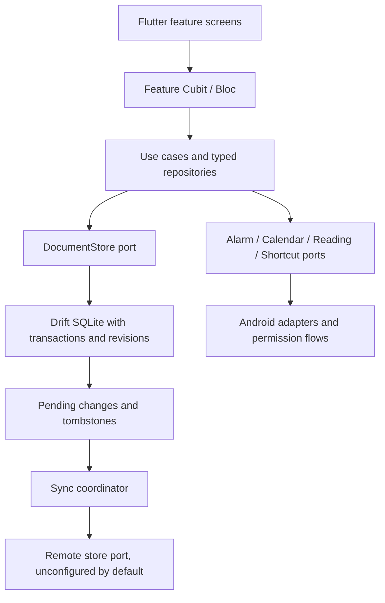

# Tawabti architecture

## Requirements and scope

Personal mobile companion: Umrah, appointments/alarms, Quran wird, voluntary
worship, prayer tracking, historical missed-prayer ledger, shortcuts and a
multimedia library. Arabic first, with English and Urdu retained. User selected
local storage now and server integration later; reading opens an external app
without overlays or usage surveillance.

## Planning assumptions and capacity

One local user per installation. Plan for tens of thousands of small activity
records over years, not a distributed backend. At ten entries/day for ten years,
there are about 36,500 records. At 2 KB/record this is about 73 MB before indexes.
Media files are not stored as SQL blobs. Server traffic/capacity remains an open
question until that phase is commissioned.

## Architecture and state management

New modules use `lib/features/<feature>/{domain,data,presentation}`. Domain code
does not import Flutter widgets or plugins. Widgets display state and dispatch
actions; they do not run SQL or HTTP. Repositories encode/decode their own DTOs.
Composition occurs in the service locator/app entry point, with constructor
injection and replaceable platform adapters for tests.

Patterns: modular monolith, Repository, ports/adapters, use cases for orchestration,
observer streams for stored state, optimistic revisions, transactional updates,
append-only activity/ledger entries and a durable pending-sync queue. Keep the
existing Bloc ecosystem; do not add a competing state framework or a class for
every trivial getter.

## Persistence model

`FeatureDocuments` has composite `(namespace,id)` key; JSON payload,
schemaVersion, revision, updatedAt UTC, optional sortKey, deletedAt tombstone,
and pendingSync. Feature payloads are validated in typed data repositories.
Calendar dates for worship are explicit local day keys; scheduled instants are
UTC. Existing prayer/tasbih/Umrah/Quran tables remain intact.

## API and platform contracts

`DocumentStore`: get/list/watch/upsert/delete/transaction/pendingSync/markSynced.
Each update increments revision. A sync acknowledgement clears pending only if
its acknowledged revision still matches, so a later local edit cannot be lost.

Android MethodChannel: `app.tawabti/features`.

- Calendar: `calendar.list`, `calendar.events`, `calendar.create`,
  `calendar.update`, `calendar.delete`.
- Reader: `reader.apps`, `reader.open`.
- Shortcuts: `shortcuts.supported`, `shortcuts.pin`, `shortcuts.dynamic`,
  `shortcuts.initial`; native event `shortcut.open`.

Future server contract: authenticated document upsert/list, stable document IDs
and idempotency keys based on ID/revision. No network adapter is activated or
data sent by default. Meet conference creation is a separate capability requiring
Google authorization; an existing HTTPS Meet link works locally now.

## Reliability, privacy and scaling

Local writes are transactional and readable immediately. Alarms/calendar calls
are explicit side effects with visible failure states; denied permissions do
not erase appointments. Async state updates check disposal and request ownership.
Deletion uses tombstones for future sync. Outbound retries are bounded and keep
the local pending queue. Imported calendar/reading-app data is requested by the
user and is never silently uploaded.

Query by namespace/sort range with indexes and bounded UI lists. Add paging and
server batching when measured counts justify it. Do not introduce microservices,
Redis or a message broker merely for this personal mobile client.

## Failure scenarios and open setup

Storage failure preserves current form/count; notification denial exposes a
settings/retry path; missing reader app exposes a usable fallback; OAuth/server
not configured is displayed as unavailable; corrupt media/URL never blocks text
reading. Native iOS integrations and Google conference provisioning require
platform configuration/validation. Backend identity, conflict policy and media
hosting will be finalized in the server phase.
